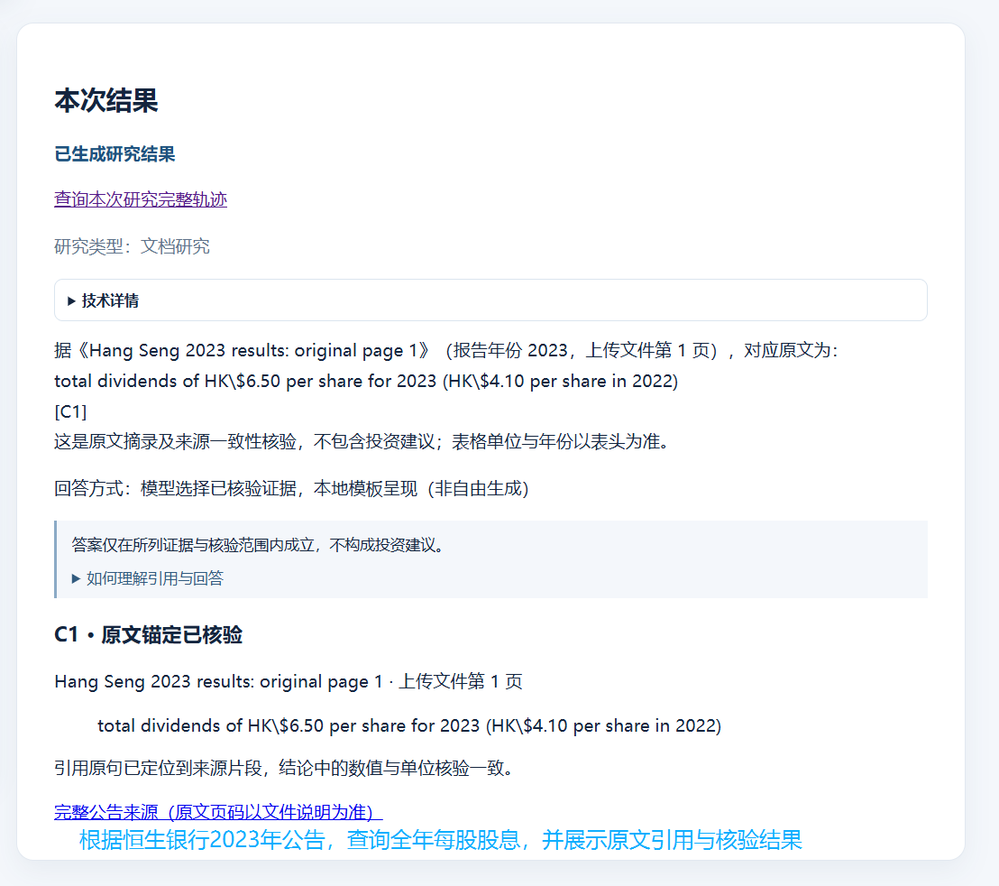
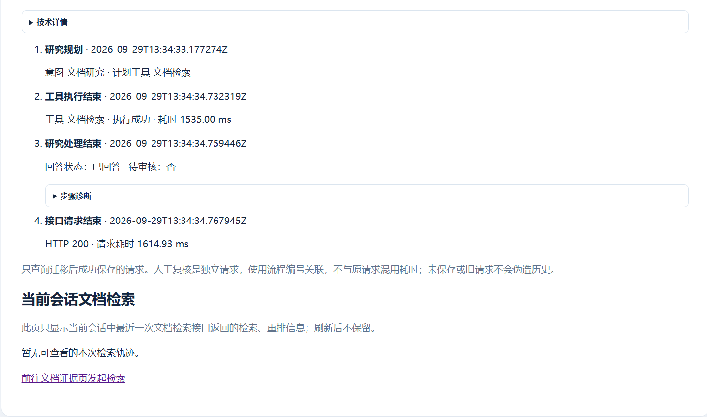
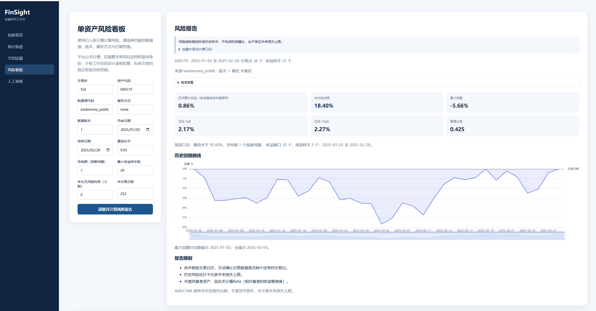
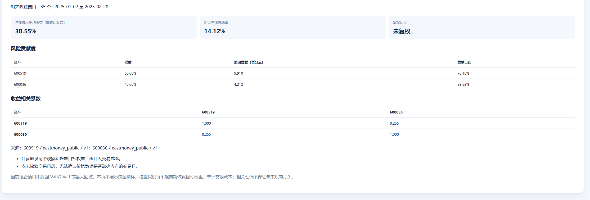
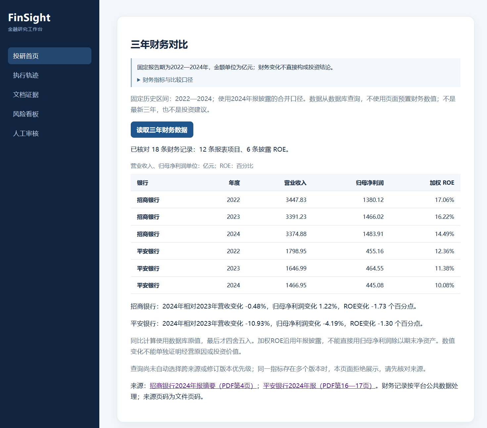
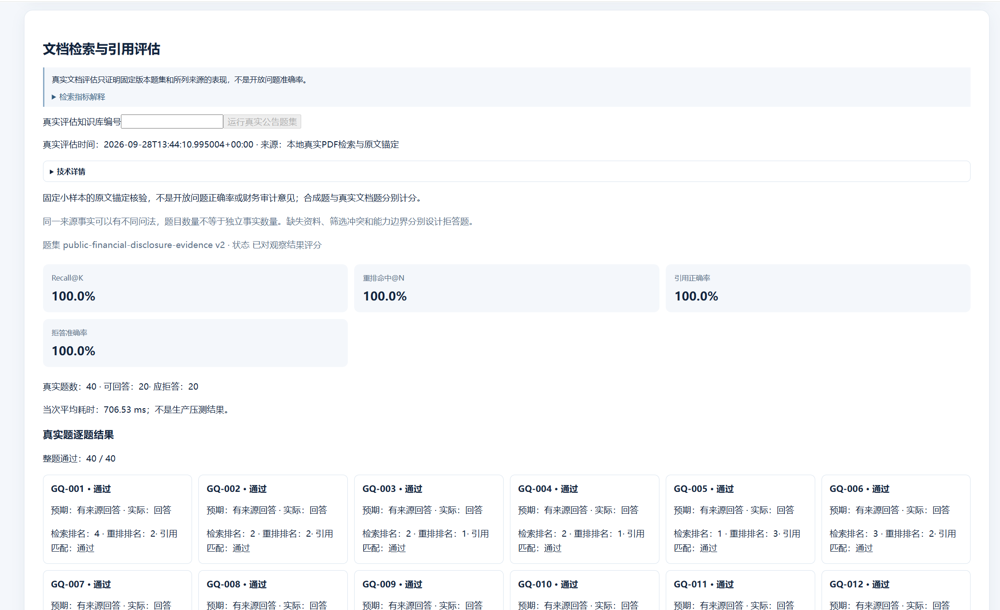

# FinSight 金融投研与风险决策平台

我将金融文档检索、证据核验、结构化查询、确定性风险计算、权限控制和人工审核串联为一个已验证的本地演示项目。本项目不是生产级交付包，不保证回答任意金融问题或改善投资收益。

## 已实现模块

- FastAPI、PostgreSQL、Alembic：接口、存储与迁移。
- MinerU、BGE-M3、Milvus及重排模型：解析、混合检索与证据排序。
- LangGraph：研究流程、检查点与人工审核。
- SQL守卫与确定性Python风险计算。
- Redis异步任务、Worker及Dispatcher心跳、调用预算。
- JWT、工作空间角色、知识库授权与敏感操作审计。
- React、TypeScript、ECharts：研究、轨迹、证据、风险、评估及审核页面。
- DeepSeek官方接口：仅对许可的公开证据选择原句，本地模板呈现；包含超时、有限重试及失败回退。

## 实际范围与限制

我已验证本机部署及有限公开样本链路。财务对比固定为2022—2024年；保存的40题评估只有4个独立事实，不能推广为金融领域准确率，也不是新接入模型的全面效果评测。

隔离恢复不等于异地灾备或跨机器即用。完整演示视频尚未录制。公告问答、银行财务及股票风险使用不同样本，不能拼成同一家公司的完整分析。

## 源码结构

- `src/finsight/`：接口、领域契约、服务、基础设施及任务入口。
- `alembic/`：数据库迁移。
- `WebApp/`：前端与测试。
- `tests/`：后端测试及合成样本。
- `Evaluation/`：评估契约、公开问题及来源摘要白名单。
- `docs/`：当前生成接口边界与页面展示说明；历史规划和学习笔记仅保存在本地。

## 页面展示

我选取以下六张截图展示核心流程；[完整八张截图与说明](docs/Screenshots/README.md)包含文档检索和历史人工审核样例。截图来自本机实际运行，已去掉展示中不必要的内部编号；不是生产验收或性能承诺。

### 公告回答与来源核验

我根据恒生银行2023年公告查询全年每股股息，展示原文引用、C1核验及实际回答方式。模型选择已核验证据，由本地模板呈现，不是自由生成任意金融结论。



### 研究执行轨迹

我保存研究规划、工具执行、回答状态与接口耗时。当前会话检索缓存与已保存研究记录相互独立，底部暂无会话检索不代表上方研究失败。



### 单资产历史风险

我基于600519在2025-01-02至2025-02-28的已入库行情计算指标，并保留36个价格点、35个收益样本及中文报告限制。历史VaR/CVaR不等于未来损失上限。



### 组合风险与贡献

我以600519/600036、60%/40%权重计算共同日期窗口下的组合波动、风险贡献及相关性。年化算术平均收益不是区间累计收益，当前组合接口不返回VaR/CVaR或最大回撤。



### 三年公开财务对比

我展示招商银行和平安银行2022—2024年的18条公开财务记录，金额单位亿元，ROE沿用年报披露口径。该区间固定，不是滚动最新三年；两个银行样本与公告、股票风险样本不是同一企业。



### 固定公告题集评估

我展示已保存的40题观察评分，其中20题可回答、20题应拒答，只有4个独立来源事实。画面中的100%只适用于该固定题集，不代表开放问题准确率、新接入模型全面效果或生产压测结果。



## 开发与测试

```powershell
uv sync --extra dev
uv run pytest -q
```

前端测试与构建：

```powershell
cd WebApp
npm ci
npm run test
npm run build
```

我在2026-09-29的展示整理验收中运行了81项前端测试，全部通过，TypeScript与Vite构建成功。风险页分包约544.73kB仍有体积警告，这不是构建失败，也不表示已完成性能优化。本轮没有重新运行整套后端测试。

部分集成测试需要数据库、Redis、解析服务或本地模型；缺少依赖时可能跳过，跳过不等于通过。

`.env.example`、`docker-compose.yml`和`scripts/dev.ps1`是早期开发示例，不是当前整套部署配置。示例凭据不可用于公开服务；当前部署在仓库外独立管理，使用专属端口。启动前必须准备配置、随机认证密钥、模型路径和授权，不会自动导入本机账号及数据。历史文档的旧路径、端口或待办不能当作当前部署指令。

生成接口由`FINSIGHT_GENERATION_*`配置控制，默认关闭。旧示例中的`LLM_API_KEY`不是当前生成链路的配置入口。见[接入契约](docs/GenerationContract.md)与[业务链路](docs/GenerationBusinessFlow.md)。

## 发布与安全

我只发布源码、测试、公开评估契约和说明文档，不发布真实密钥、账号配置、数据库、原始文档、模型权重、TLS私钥、备份或验收运行记录。测试中的虚构账号和示例字符串不代表真实登录账号。

克隆源码不会获得本机数据及模型，也不会直接复现完整部署。部署配置、样本许可、依赖和密钥须另行准备。
