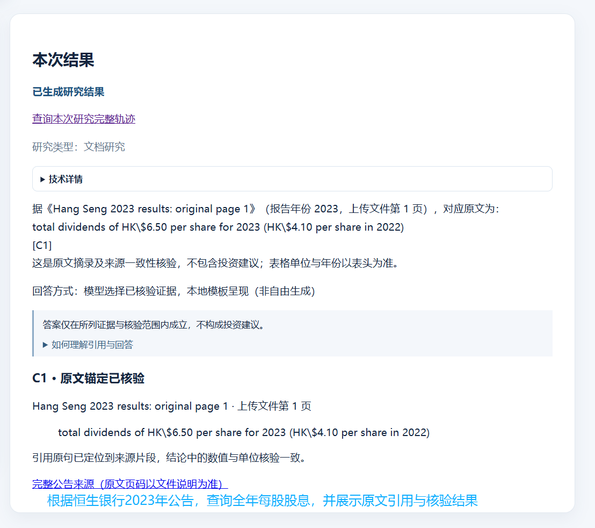
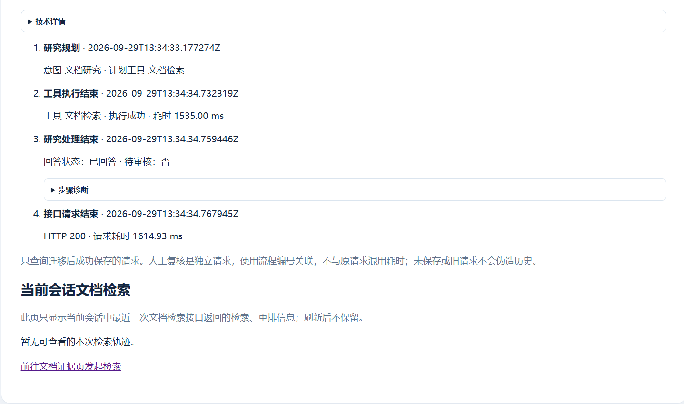
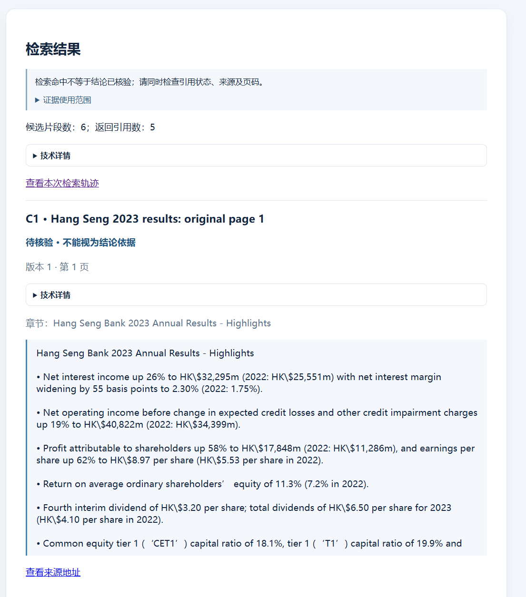
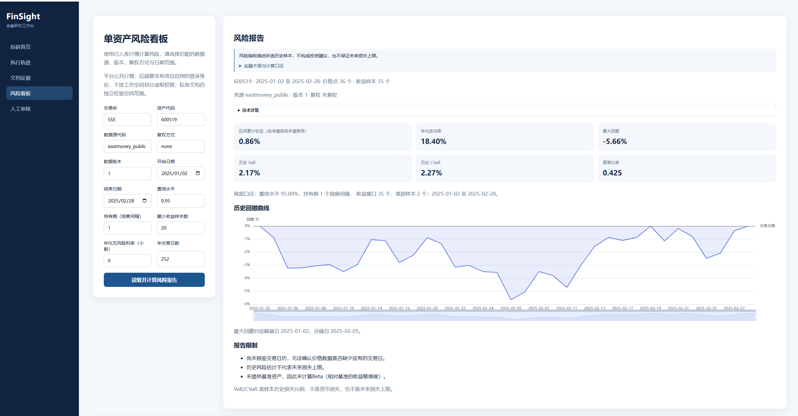
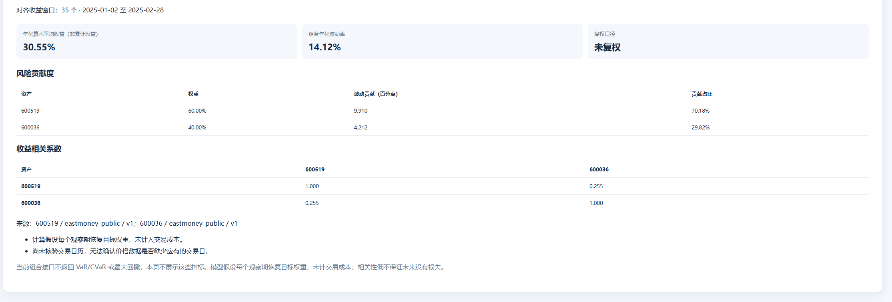
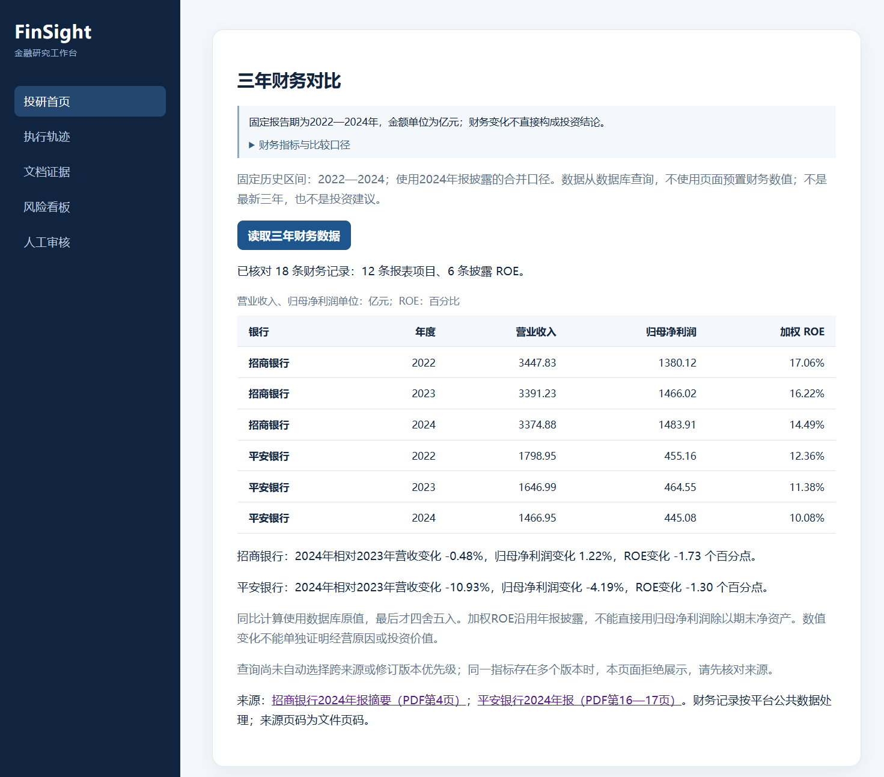
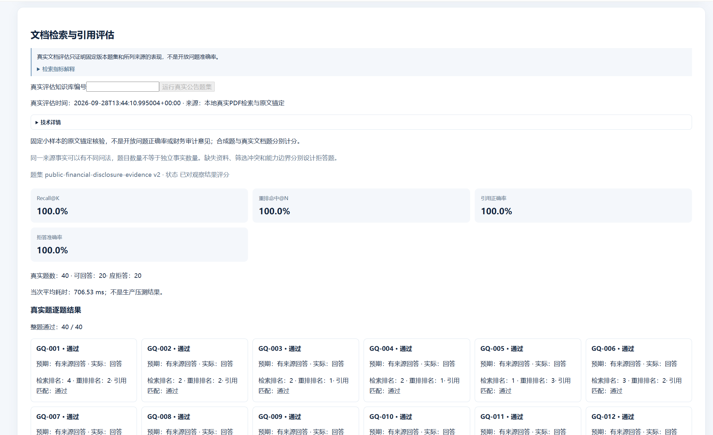
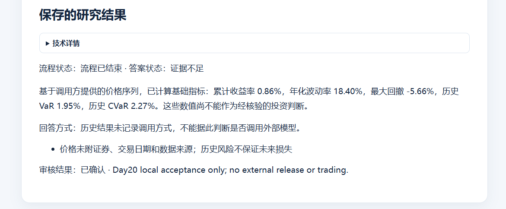

# FinSight 页面截图

我保留八张本机实际运行截图，展示功能与边界，不将其作为生产级验收证明。点击图片可查看原尺寸。

## 01 公告回答与核验引用

我根据恒生银行2023年公告查询全年每股股息，展示原文、C1、来源一致性核验和实际回答方式。回答范围受证据限制，不构成投资建议。

## 02 已保存研究执行轨迹

我展示研究规划、工具执行、回答状态和请求耗时。内部编号已裁去，技术详情与步骤诊断折叠。底部暂无当前会话检索缓存，不否定上方已存储研究记录。

## 03 文档证据检索

我展示6个候选片段、5个返回引用及来源片段。待核验候选不能直接当作已核验结论；英文内容是公告原文，画面不是完整公告。

## 04 单资产历史风险

我基于600519在2025-01-02至2025-02-28的历史行情计算风险；36个价格点、35个收益样本，不保证未来损失。未提供基准时不计算Beta，交易日历尚未核验。

## 05 组合风险：600519/600036，权重60%/40%

我通过35个共同收益窗口计算组合波动、风险贡献与相关系数。模型假设每期恢复目标权重，未计交易成本；年化算术平均收益不是累计收益，当前接口没有组合VaR/CVaR或最大回撤。

## 06 三年公开财务

我展示招商银行、平安银行2022—2024年财务对比：18条记录，收入和利润单位亿元，ROE按年报披露。同比百分比与ROE变化百分点分别表达，不以财务变化直接证明投资价值。

## 07 固定真实公告题集的既有观察评分

我展示40题固定题集，其中20题可回答、20题应拒答，只有4个独立事实。100%是这组固定样本的观察结果，不是开放金融问题准确率，也不是新接入模型全面效果评测。真实文档与合成题分别计分，耗时不是生产压测结果。

## 08 历史人工审核样例

我展示已确认的历史审核记录，但答案状态仍是证据不足。人工确认不等于来源核验，不会自动对外发布、执行交易或成为投资判断。历史调用方式未记录，不能据此断言曾调用外部模型。

我保留英文历史审核备注，不改写原始记录。这条历史记录的VaR为1.95%，与第04张独立报告的2.17%不是同一次结果，不能混用为同一报告。

## 展示范围

我使用的是不同来源样本：恒生银行公告、招商银行和平安银行财务、600519与600036行情，不能拼成同一家公司的完整研究。源码克隆不包含本机数据库、账号、原始PDF、密钥及模型权重；启动条件见[项目说明](../../README.md)。
